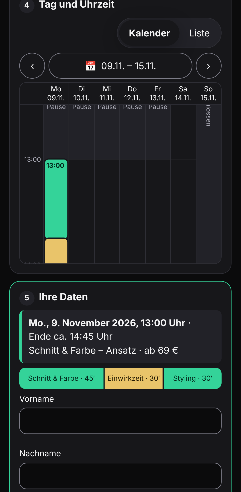
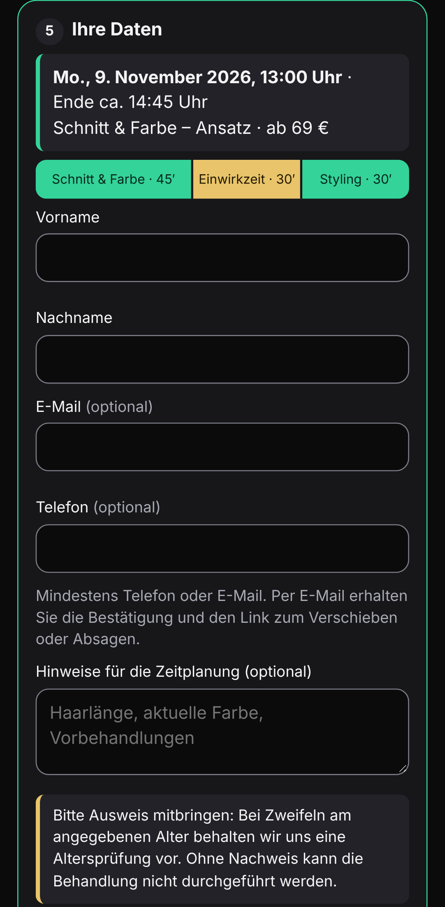
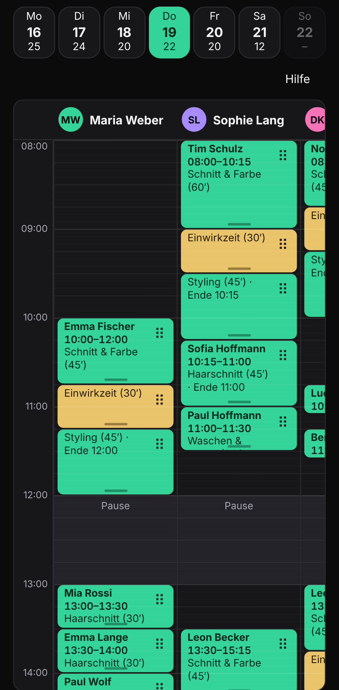
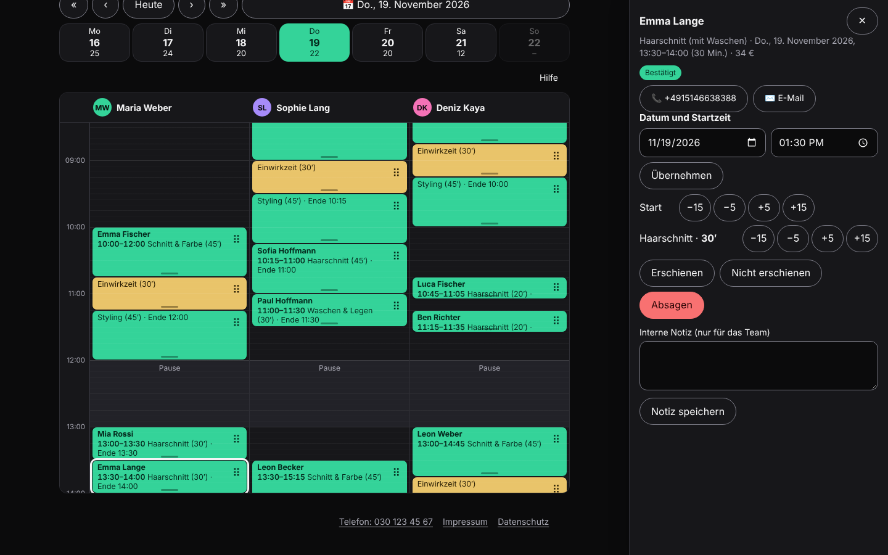

# Salon booking platform

Online booking for hair salons in Germany – **no client account**, every online booking is a **request the salon confirms**, a phase-aware staff calendar with drag & drop, and a scheduling engine that makes double bookings impossible down to the database.
UI in German (i18n ready for Italian and English), code and docs in English. Built as a portfolio project for *Fachinformatiker/in für Anwendungsentwicklung*: requirements → research → specification → tested implementation.

> **Kurz auf Deutsch:** Multi-Salon-Plattform zur Online-Terminanfrage ohne Kundenkonto. Der Salon bestätigt jede Anfrage. Behandlungen mit Einwirkzeit werden als belegte und freie Blöcke geplant; Doppelbuchungen verhindert ein Exclusion-Constraint in PostgreSQL. Barrierefrei nach WCAG 2.2 AA, datensparsam nach DSGVO.

| Client (Pixel 7) | | Staff – Team view (Pixel 7) |
|---|---|---|
|  |  |  |



## Run it

**Option A – Docker (one command):**

```bash
docker compose up --build
```

**Online demo from a Windows PC:** double-click `demo-online.cmd` (Docker Desktop running, `winget install Cloudflare.cloudflared` once). It starts the Docker demo, opens a temporary `trycloudflare.com` tunnel, sets `PUBLIC_BASE_URL` in a git-ignored `docker-compose.override.yml`, prints the public links and undoes everything when you press Enter. Demo settings stay on (public demo passwords, dev mailbox): no real client data. `demo-online.cmd -Build` rebuilds the image first.

**Option B – local Node 22 + PostgreSQL 16 (three commands):**

```bash
pnpm install
pnpm seed            # creates the schema and the demo data (DATABASE_URL, default postgres://postgres@localhost:5432/salon)
pnpm dev             # API on :3000, web on :5173
```

Then open:

| URL | What | Login |
|---|---|---|
| `/salon-beispiel` | salon homepage (D-052) | – |
| `/salon-beispiel/buchen` | client booking page | – |
| `/salon-beispiel/team` | staff area | `maria` or `maria@salon-beispiel.example.com` (owner), `sophie`, `deniz` – password `demo-passwort-2026` |
| `/admin` | platform operator | `admin` or `admin@plattform.example.com` – same password |
| `/api/openapi.json` | OpenAPI 3.1 | – |
| `/api/dev/mailbox` | e-mails "sent" in dev mode | – |

The demo seed is deterministic: two salons (isolation demo), three stylists, a price list and ~1 500 appointments over the next three months filling **≈ 70 %** of working time, plus a few open requests. All names are invented; e-mails use `example.com`.

## What it does

**Clients:** Damen/Herren + *volljährig ja/nein* → service → option → duration bar (busy/free segments) → week calendar Mon–Sun (break and closed days visible; list view as accessible alternative) → details → **"Termin anfragen"**. The slot is reserved until the salon answers. Month sheet with 12 month chips, dots on days with free slots, *Heute*, *Nächster freier Termin*. A management link (no account) to view, reschedule or cancel and to add the appointment to Apple/Google/Outlook calendars once confirmed.

**Staff:** *Mein Tag* (own clients, day/week) and *Team* (one column per stylist). Drag & drop with pointer events – move (also to another day or stylist), resize every phase, 5-minute snap, live validation (red + reason) – with a complete keyboard/panel alternative and undo/redo. Requests inbox (accept / decline / *Rücksprache*), no-show and Balayage fee record, absences, internal notes, ID-check outcome, client search, data export and deletion.

**Owner:** price list, opening hours with conflict preview, theme (contrast-checked presets), team accounts. **Platform admin:** salons, logo upload (only this role), activation.

**Rules** (all in [`packages/config/src/salon.config.ts`](packages/config/src/salon.config.ts), validated at start-up): Mon–Fri 08–17 with break 12–13, Sat 08–14, Sun closed, Europe/Berlin incl. DST; no block – not even *Einwirkzeit* – in the break; durations per audience (men's cut 30′, women 30′/45′); colour chain *work → 30′ Einwirkzeit (stylist free) → styling 30/45′*; Strähnen 45/60′ + Einwirkzeit + cut + styling; Balayage 4 h only at 08:00/13:00 (Saturday morning only) with a fee computed from the typical damage; Dauerwelle 120′ consecutive; no colour/Strähnen/Balayage/Dauerwelle for minors; client slots every 15′, staff edits every 5′.

## Architecture

```
packages/engine   pure TypeScript scheduling library – no UI, no DB
                  services → busy/free blocks, placement rules, slot search,
                  multi-stylist, DST-safe Europe/Berlin conversion, policies
packages/config   the salon template (rules as data) + profile placeholders
packages/i18n     German source strings; Italian/English prepared (fallback to German)
apps/api          Hono + @hono/zod-openapi (REST, OpenAPI from the same Zod schemas)
                  PostgreSQL via plain SQL, outbox for e-mails, background workers
apps/web          React 19 + Vite + TanStack Query; staff/admin code lazy-loaded
e2e               Playwright (iPhone/WebKit, Android, desktop), axe, visual, Lighthouse, perf
```

```
 browser ──HTTPS──> API (Hono) ─┬─> engine (rules)        same code validates in the browser
                                ├─> PostgreSQL            EXCLUDE USING gist (stylist, tstzrange) WHERE busy
                                └─> outbox ──worker──> SMTP (dev: mailbox) · WhatsApp prepared/off
```

How double booking is prevented (in order): the UI only offers valid slots → the API re-checks every rule with the engine inside a transaction holding an advisory lock per stylist and day → **an exclusion constraint on busy time blocks** rejects overlaps even if everything above were bypassed. Requests carry an idempotency key; staff edits use optimistic locking (`version`).

Decisions and alternatives: [`docs/decisions.md`](docs/decisions.md). Market research behind the feature set: [`docs/research.md`](docs/research.md). Specification: [`docs/spec.md`](docs/spec.md). Requirement → test map: [`docs/traceability.md`](docs/traceability.md).

## Quality

| | |
|---|---|
| Engine | 94 unit + **property-based** tests (fast-check): no overlap, never in break/outside hours/absence, no forbidden service for minors, DST consistency against a Temporal oracle, idempotency, slot search sound & complete; coverage ≈ 99.7 % |
| API | 46 integration tests on real PostgreSQL: approval flow, expiry, digest, reminders, fee, birthday discount, **20 parallel bookings → exactly one succeeds**, raw-SQL overlap rejected, tenant isolation, CSRF, sessions, rate limits, lockout, SVG sanitising |
| E2E | Playwright on 3 device profiles: booking, manage link, drag & drop (move, invalid drop, other day, resize, other stylist), keyboard, undo, **axe WCAG 2.2 AA**, 44 px targets, **visual regression**, performance (API p95 < 50 ms with the demo data, no long tasks while dragging) |
| Lighthouse | mobile preset: performance 96, accessibility 100, best practices 96, SEO 91 (booking page) |
| Security | OWASP Top 10 measures: parameterised SQL, React escaping + strict CSP, `HttpOnly; Secure; SameSite=Strict` session, CSRF (custom header + origin), Argon2id, account lockout, rate limits, HMAC links, self-hosted proof-of-work instead of third-party CAPTCHA, no secrets in the repo, `pnpm audit` in CI |
| Privacy | data minimisation, no trackers, retention job, export/deletion – see [`docs/legal.md`](docs/legal.md) |

Commands: `pnpm lint`, `pnpm typecheck`, `pnpm test` (engine + web + API; needs PostgreSQL), `pnpm test:e2e`, `pnpm lighthouse`. CI: [`.github/workflows/ci.yml`](.github/workflows/ci.yml).

## Deployment notes

Set `NODE_ENV=production`, `APP_SECRET` (≥ 32 chars), `DATABASE_URL`, `PUBLIC_BASE_URL`, `MAIL_MODE=smtp` + `SMTP_URL` (EU provider with DPA), `TRUST_PROXY=true` behind a reverse proxy with HTTPS. The server refuses to start in production with test-only settings (`FAKE_NOW`, `DEV_ROUTES`, `RATE_LIMIT_SCALE`, default secret).

## Known limitations

- Rate limits and login lockout are in memory (one instance). For several instances use a shared store (e.g. Redis/PostgreSQL).
- The API runs TypeScript through `tsx` also in the container; a compiled build would start faster.
- Tenant isolation is enforced in the application layer and tested; PostgreSQL row-level security would be a second layer.
- Services and durations are edited in the services editor (owner: Einstellungen, platform admin: /admin, D-048). Variants, fee rules and fixed start times are not editable there yet (platform API `PUT /api/platform/tenants/{id}/services`).
- Italian and English translations are partial (fallback to German); the language switcher is not exposed yet.
- WhatsApp channel and SMS are not implemented beyond the interface (owner decision D-029).
- Visual-regression baselines exist for Chromium (Android, desktop) and are machine specific: they run locally, not on the CI runner (different fonts). The iPhone profile runs on real WebKit in CI without visual baselines.
- The WebKit run (Safari engine) exists only in CI; drag-and-drop resize was adjusted after its first CI run and still needs a green run to be confirmed.

## Not verified (honest list)

- **Docker:** `Dockerfile` and `docker-compose.yml` were written but could not be built in the development sandbox (Docker Hub blocked by the sandbox network). Option B was verified.
- **CI workflow** was not executed on GitHub yet.
- **Real devices:** tested with Playwright device emulation (Chromium); WebKit/Safari only in CI; no physical iPhone/Android test.
- **Manual screen-reader tests** (VoiceOver, TalkBack, NVDA) – checklist in [`docs/accessibility.md`](docs/accessibility.md), not executed.
- **E-mail delivery** with a real SMTP provider (only the dev mailbox was used).
- **Legal texts** (Impressum, Datenschutz, fee wording, AVV) – drafts, need a lawyer.
- **BFSG applicability to the platform operator** – open legal question.

## Assumptions to confirm with the salon owner

Most assumptions were answered by the owner on 2026-10-28 (durations, audiences, reminder, re-confirmation from 60′, fee formula). Still open: retention (owner proposed 10 years, we keep 12 months for booking data – see `docs/legal.md`) · whether absences block Einwirkzeit · same-day lead time 30′, horizon 364 days · staff may move Balayage away from 08:00/13:00 · birthday discount details · request expiry 48 h. Full list with reasons: [`docs/spec.md` §10](docs/spec.md).
